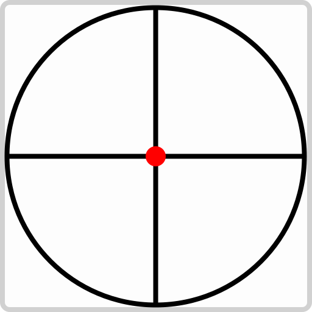

  

<h1 align="center">
  SM64 Lua Redux
</h1>

SM64 Lua Redux is the leading SM64 TASing utility.

> [!NOTE]
> SM64 Lua Redux doesn't ship standalone, get it via the repack at [mupen64.com](https://mupen64.com).

# What's new

- Themes
- Arctan straining
- Ghost playback and recording
- RNG
- Timer
- Customizable ramwatch
- Actions and Hotkeys
- Dynamic resizing[^2]
- Framewalk
- Auto firsties
- Multicontroller support
- Presets[^3]
- Customizable formatting[^6]
- 3D World Visualization[^7]

[^2]: The script will resize its elements intelligently to fit, and will thus work on small and huge resolutions
[^3]: Save and restore an infinite amount of program states. 
[^6]: The amount of decimal points values are rounded to can be changed, as well as angles being expressed as degrees or game units
[^7]: Allows you to see object positions as well as other useful information directly in the game world
